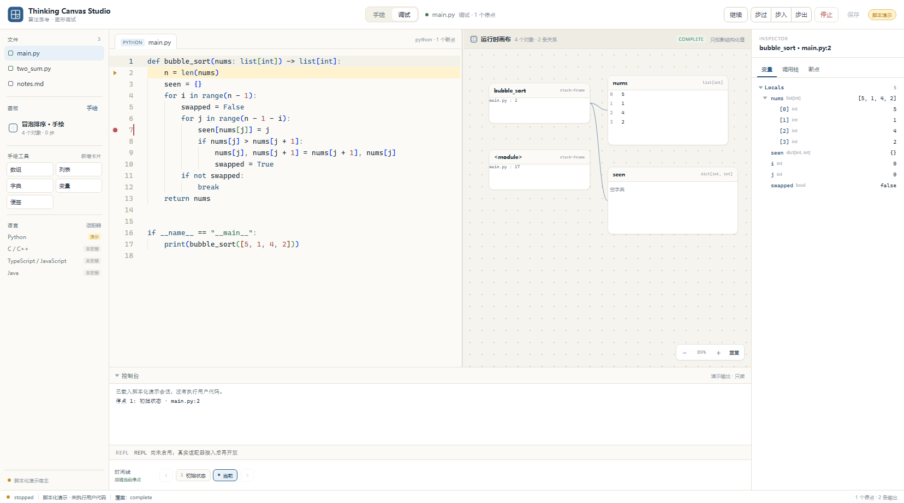
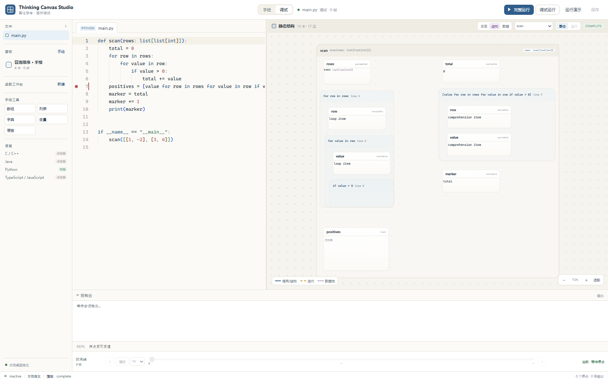
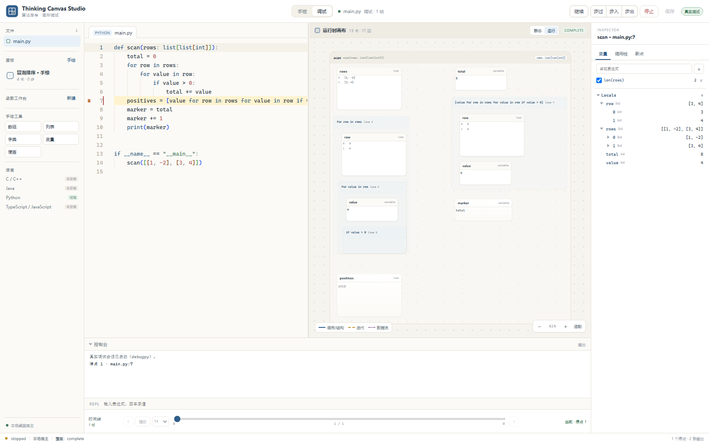

# Thinking Canvas Studio

轻量桌面代码编辑器 + 语言无关的图形化调试器。代码在 Monaco 里写，运行/单步时把变量、容器、引用、调用栈和变化投影到画布；同时保留独立的纯手绘画布。

当前是 **可运行的桌面底座**：Monaco、React 界面、共享画布、帧轴时间线、手绘模式、Python 本地宿主、WebSocket JSON-RPC 桥、**函数工作台 + 三种静态结构视图（Python / TS-JS）**，以及 **真实 debugpy + Windows Job Object** 的 Python 调试闭环。真实调试已支持变量懒加载/分页、Watch、REPL 求值和暂停；GDB（C/C++）、js-debug（TS/JS）、java-debug（Java）和 LSP 尚未接入，TS/JS 目前只有静态图。







## 快速运行

```powershell
npm install
npm run dev                 # 浏览器演示：http://127.0.0.1:5173/（脚本演示，不执行代码）
npm run build
python desktop/app.py       # pywebview 桌面窗口：可运行真实 Python
python desktop/app.py --dev # 桌面窗口加载 Vite 开发服务器
python desktop/app.py --workspace E:\my-project  # 打开已有项目，不写入示例源码
python desktop/app.py --smoke
```

桌面壳需要 `desktop/requirements.txt` 中的 `pywebview`、`websockets` 和宿主解释器里的 `debugpy`。不传 `--workspace` 时会在 `workspace/` 生成演示工作区（已忽略）；传入真实项目路径时不会写入示例源码，只会使用项目内的 `.thinking-canvas/` 工作台元数据。

## 函数工作台与静态结构

1. 在文件栏选一个 Python 文件，点“函数工作台 → 新建”。
2. 编辑器打开一个干净页面，只有一行隐藏 context 的继承 import；源文件的 import、顶层函数/类/常量会在运行时继承，源文件本身不被修改。
3. 写函数或类，点保存。右侧静态画布会用真实语法树更新；没有运行代码也能看到结构。
4. 在 `if __name__ == "__main__":` 写测试输入，点“真实运行”，debugpy 在独立工作台里执行；原生确认框显示“继承上下文”。
5. 运行时切到“运行”视图看真实变量；“静态”视图仍可切回。

静态画布有三种视图（[设计说明](docs/graph-design.md)）：

- **总览**：模块、import、类、顶层函数；方法折叠进类卡，方法调用上提到类，内置调用和调用点卡不占画面。
- **结构**：聚焦类时只显示类、基类、字段和方法，成员用网格排布；在“聚焦”里选一个方法，才展开它的参数、局部变量、循环、调用目标和返回/数据流。
- **数据**：聚焦类时只显示字段和构造输入；聚焦方法时才显示局部容器、读写和返回变量。

画布使用 dagre 分层布局、随分栏尺寸自动适配；类视图用三列成员网格，函数视图按结构树递归布局：`for/while`、`if/else`、Python 推导式都是控制框，嵌套时框套框；运行时在同一个结构骨架上叠加当前帧的值。大文件采用渐进展开：总览最多 18 个顶层符号，类视图最多 6 个字段 + 6 个方法，函数/方法视图最多 36 个节点；未显示的成员仍可在“聚焦”下拉里选择。静态分析预算 320 节点 / 520 边，命中会标记 `partial`，不把不完整结果说成完整。

Python 和 TS/JS 使用真实 AST 分析；TS/JS 目前只做文件级静态图，不执行、不调试。静态结构是启发式分析，不推断运行时对象身份；未知值不伪造。

## 完整运行、时间线与回放

- 桌面窗口有两个真实运行入口：
  - **完整运行**：自动给当前文件的每个可执行语句设断点，逐帧记录后自动继续，直到程序结束或达到 500 帧上限。适合先把整个函数跑一遍、拿到完整时间线。
  - **调试运行**：只停在你自己设的断点，适合逐步检查。
- 完整运行结束后，底部帧轴可以拖动，也可以点“播放/暂停”和 `0.5× / 1× / 2× / 4×` 调速；画布按帧更新，差异单元格/卡片高亮。
- 记录的是**实际发生过的暂停帧**，不是逆向执行；回看/播放不等于重新运行目标。
- 自动记录会改变执行速度，但不会改变程序逻辑；达到 500 帧会停止并提示。

## 真实运行怎么走

1. 在桌面窗口打开 `main.py`（或工作区里的其他源码），在行号左侧设置断点。
2. 点“真实运行”。宿主弹出**原生确认框**，列出程序、工作区、解释器、断点、资源限额。
3. 点“是”后，host 签发单次 approval receipt，启动受 Job Object 限制的 debugpy；界面出现真实变量、调用栈、画布和时间线。
4. 继续/步过/步入/步出由 DAP 驱动；“暂停”会停在当前位置；“停止”会结束调试进程树。
5. 变量树支持“加载更多”：长数组不会一次塞满 DOM，分页读取需要该会话的求值授权；Watch 和 REPL 在当前停点执行表达式，结果按停点代际校验。
6. 没有原生确认、没有 supervisor、或文件在确认后又被改动，都不放行。

资源限额默认：600 秒墙钟 / 512 MB / 120 秒 CPU / 8 个进程。真实运行只在桌面窗口可用；浏览器预览固定使用脚本演示。

## 验证

```powershell
npm run typecheck
npm test                    # 19 项核心逻辑测试
npm run test:python         # 57 项宿主测试（含静态分析/TS 分析、工作台、真实 debugpy、分页/求值、自动记录、Job Object）
npm run build
```

## 目录

```text
frontend/
  src/                      React 壳、Monaco、画布、面板、时间线、宿主客户端
  core/                     纯 TS：调试模型、场景投影、卡片、差异、快照
  tests/                    Node 原生测试
desktop/
  app.py                    pywebview 入口、静态服务器、原生运行确认
  studio_host/              WS 桥、工作区、DAP 会话、debugpy、Job Object、脚本演示、授权策略、图视图
  analyzers/                TS/JS 静态分析器（TypeScript compiler API，Node 子进程）
languages/                  语言包 manifest（Python 可用；其余未安装）
docs/                       产品、架构、数据、契约、spike、进度、交接、截图
```

## 产品边界

- **编辑时不会知道运行时内存**。变量、容器和内存结构只在启动/停点后采集；不把静态推测冒充实测。
- **DAP 给的是变量树与临时句柄，不是完整内存图**。画布只投影结构化值；标量留在变量表。
- **连续运行只保留已采集的暂停快照**。没有逐步事件时明确标记 gap，不插值伪造中间状态。
- **手绘画布与调试快照是两套事实**。它们共享 Scene/Card 渲染器和文件管理，但不会互相覆盖。
- **当前 Python 调试是真实执行**，仍不是完整沙箱：Job Object 限制的是进程资源，不是文件/网络权限；只运行你确认过的本机代码。
- **静态结构 ≠ 运行时事实**：静态分析只根据 AST 和已知源码上下文；运行时变量、对象别名、调用顺序以 debugpy 为准。
- **静态图是渐进展开的摘要**：总览/类/方法各有节点上限；大文件命中预算时显示 `partial`。未显示的成员可以通过“聚焦”继续查看，不会假装一次画完整文件。
- **TS/JS 只有静态图**：使用 TypeScript compiler API 解析单文件，不做类型检查、跨文件符号解析或运行；不能据此声称 TS/JS 调试已可用。
- **Watch/REPL/分页可能执行用户代码**：真实运行的原生确认明确包含“允许在当前停点执行 Watch/REPL 表达式”；没有该授权时不求值。DAP 不提供任意时刻的实时值，Watch 只在停点刷新。
- **长容器分页**：长数组/列表默认加载首批 100 项，UI 可继续加载；画布卡片只画窗口并显示省略号/已显示数量，不把全部数据塞进 DOM。字典/集合在适配器不支持分页时会提示无法继续。
- **时间线是有界帧轴**：最多保留最近 500 帧，超过后显示丢弃数；不把 1 万步排成一长排。
- **完整运行 vs 交互调试**：完整运行自动逐帧记录；交互调试只停在断点。回放帧不是活进程，不能把回看当成真实回退。

## 下一步

1. 调试 P0b：条件/日志/异常断点、改变量、重启、线程/栈分页、调试控制台能力矩阵；当前已有变量分页、Watch、REPL、暂停。
2. 运行时画布 v2：函数/栈帧大方框、变量卡内含、赋值/迭代边、循环轨道、张量卡、图例/视觉语法；当前画布仍是平铺卡片。
3. 真实窗口 IME/DPI/快捷键/崩溃恢复验收；当前是隐藏窗口 + 浏览器/无头 Edge 证据。
4. 跨文件符号解析、递归/超大类的分层展开；当前用聚焦和阅读上限做渐进展开。
5. 时间线 UI 精修：帧轴缩略图、播放循环、按函数/行过滤帧；当前先保证后端记录与播放可用。
6. C/C++/Java 静态分析器（真实解析器，不用正则伪造 AST）；GDB、js-debug、java-debug + JDT LS 的调试适配器。每种语言单独验收。
7. LSP 接入前先测 `monaco-languageclient` 体积、取消、旧版本诊断丢弃。
8. 画布增强：更多容器/张量、别名证据、采集预算/coverage、trace 持久化、手绘完整笔迹/连线；前端视觉与交互大改由主人后续定方向。

## 旧项目

`E:\算法思考工具` 是上一代产品，只作为视觉、卡片和时间线的只读参考。它不是本仓库的代码基座；本仓库按新目标独立实现。旧项目不修改、不迁移。

MIT，见 [LICENSE](LICENSE)；依赖与来源见 [docs/third-party-licenses.md](docs/third-party-licenses.md)。