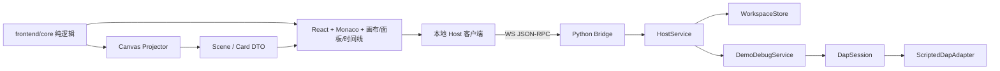

# 架构与决策

更新：2026-10-23。本文件描述当前可运行底座，不是完整 IDE 的完成声明。

## 总览

演示路径使用 `ScriptedDapAdapter`（不启动进程）。真实 Python 路径使用 `RealDebugService` + `DapSession` + `WindowsJobObjectSupervisor`：原生确认后签发单次 receipt，Job Object 限制进程时间/内存/进程数，debugpy 通过 loopback DAP 连接。GDB/js-debug/java-debug 仍待接入。

## 分层与所有权

| 层 | 位置 | 负责 | 禁止 |
|---|---|---|---|
| React 壳 | `frontend/src/app`、`panels` | 布局、面板、工具栏、时间线、交互 | 自行持有第二套运行事实 |
| 编辑器 | `frontend/src/editor` | Monaco、语言、主题、断点 gutter、当前行 | 把编辑器内容当运行结果 |
| 画布 | `frontend/src/canvas` | Scene/Card 渲染、缩放/平移、选择、拖动、差异高亮 | 根据展示字符串猜地址/别名 |
| 纯核心 | `frontend/core` | 调试状态机、请求代际、投影、Trace/Manual 文档、卡片/差异 | DOM、网络、文件、进程 |
| Host 客户端 | `frontend/src/host` | Demo 与 WS 两种实现、RPC/事件 | 把 token 放进 URL 或日志 |
| 全局状态 | `frontend/src/state` | 选择、模式、快照索引、手绘文档、UI 状态 | 复制运行事实 |
| 桌面壳 | `desktop/app.py` | pywebview、静态服务器、bridge_info、生命周期 | 在 renderer 中启动进程 |
| 本地桥 | `desktop/studio_host/bridge_server.py` | loopback WS、token、Origin、JSON-RPC allowlist | 暴露 grant/任意路径/任意 DAP |
| 工作区 | `desktop/studio_host/workspace.py` | 路径约束、原子写、boards | 目录穿越、部分覆盖坏文件 |
| 调试服务 | `desktop/studio_host/debug_service.py`、`real_debug_service.py` | DAP → 归一化事件、采集预算、coverage | 把展示字符串当内存 |
| DAP 会话 | `desktop/studio_host/dap_session.py` | request_seq、事件、超时、反向请求默认拒绝 | 把 DAP 当 JSON-RPC |
| 语言包 | `languages/*/manifest.json` | 扩展名、adapter、launch 模板、状态 | 把运行时打进 exe |
| 执行策略 | `execution_policy.py`、`windows_supervisor.py`、`host_approval.py` | 默认拒绝、原生确认 receipt、Job Object 限额、进程树回收 | 无 supervisor 时放行 |

## 关键 ADR

| 编号 | 决策 | 理由 / 当前边界 |
|---|---|---|
| ADR-001 | 新仓库独立实现；旧 `E:\算法思考工具` 只读参考 | 新产品是编辑器 + 图形调试器，不是旧画布续作；旧项目不迁移、不修改 |
| ADR-002 | React 19 + Vite + Monaco | 多面板状态适合 React；Monaco 与 VSCode 编辑器同源；不复制 workbench |
| ADR-003 | pywebview + WebView2 | 轻量桌面壳；静态服务器 + 本地桥；窗口/IME/DPI 仍需真实验收 |
| ADR-004 | loopback WebSocket JSON-RPC | 命令与事件分离；token 认证、Origin 限制、方法 allowlist；不用 URL 传 token |
| ADR-005 | DAP 作为语言无关调试协议 | 统一请求/事件/能力；脚本化适配器先打通 UI；真实适配器逐个验收 |
| ADR-006 | 手绘与调试共用 Scene/Card 渲染器，独立文档 | 视觉一致；事实源分离；手绘内容不被快照覆盖 |
| ADR-007 | 暂停快照 + 时间线，不假装记录每次赋值 | DAP 主要在停点给数据；连续变化需要额外采集；缺失标 gap |
| ADR-008 | 运行默认拒绝，真实 supervisor 前不执行用户代码 | 防止无限制进程；脚本演示明确标记，不冒充真实调试 |
| ADR-009 | 语言包声明式 manifest | 语言运行时按需安装；首版四语言但逐个验收 |
| ADR-010 | Trace 剥离临时句柄；布局键与对象身份分离 | 旧句柄不能跨停点；布局稳定不等于对象相同 |
| ADR-011 | 真实运行：原生确认 → 单次 receipt → GrantAuthority → Job Object | JS 布尔值不能当授权；文件内容 hash 进 config digest；没有 OS 限额不放行 |
| ADR-012 | debugpy 用 attach 模式（`--wait-for-client` + 目标脚本） | debugpy 1.6.7 CLI 需要目标；DapSession 发 attach；`justMyCode: true` 过滤内部帧 |

## 一次单步的数据流

1. React 点击“步过”→ `HostClient.stepDebug` → WS `debug.step`。
2. `HostService` → `DemoDebugService.step` → `DapSession.request("next")`。
3. 适配器返回 response，并发出 `continued`、`stopped` 事件。
4. `DebugService` 归一化为 `threadResumed` / `threadStopped` / `framesLoaded`，通过 WS 通知推送。
5. `StudioStore` 用 `reduceDebugEvent` 做 run/session/stopEpoch 校验；旧回包被拒。
6. `createTraceSnapshot` 剥离句柄并冻结；`projectSnapshot` 生成 Scene/Card；`diffScenes` 标出变化。
7. Canvas 渲染卡片/边；Timeline 追加停点；Inspector 显示变量和调用栈。

## 真实 vs 演示

| 能力 | 当前状态 |
|---|---|
| Monaco 编辑、语法高亮、断点 gutter、当前行 | 已实现；浏览器实测 |
| 脚本化 DAP：停点、步过、变量、调用栈 | 已实现；Python 宿主测试 + 浏览器实测 |
| WebSocket 桥：token、Origin、allowlist、广播事件 | 已实现并测试 |
| 工作区读写、boards 原子保存 | 已实现并测试 |
| 手绘卡片/拖动/记录步骤 | 基础实现；完整笔迹/连线/文本编辑待补 |
| 真实 debugpy（Python） | 已接入并测试：断点、单步、locals、list、Job Object 回收 |
| GDB / JS / Java | 未接入 |
| LSP/补全/诊断 | 未接入 |
| 强制超时/CPU/内存/子进程监管 | Windows Job Object 已实现并测试；Linux 未实现 |
| pywebview 真窗口 IME/DPI/崩溃恢复 | 隐藏窗口基础加载与真实运行通过；IME/DPI/崩溃恢复未验收 |

## 已知风险

- Monaco 主包约 3.0 MB（gzip 约 0.8 MB），语言 worker 另计；LSP 接入前必须测体积。
- `ScriptedDapAdapter` 的变量树是演示数据；不能据此声称真实语言支持。
- 连续运行的完整动画尚未解决；当前只保证停点快照。
- Windows Job Object 不是文件/网络沙箱；只限制进程资源，运行前仍需用户确认。
- debugpy 断点只在启动时下发；运行中改断点尚未同步。
- 手绘编辑器功能范围明显小于旧版；旧版的笔迹/橡皮/连线清理尚未移植。
- 桌面桥 token 由 pywebview `bridge_info` 提供；窗口 API 注入慢时需要等待，不能把“窗口出现”当“桥可用”。