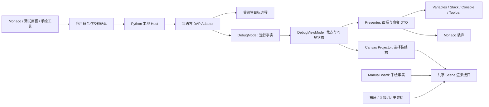

# 审查结论与架构决策

日期：2026-10-23。结论：**有条件通过方向，重写技术承诺与实施顺序。** 新建独立仓库合适；保留 pywebview 作为待验证的壳候选，并不等于继续旧应用的全局状态和 DOM 结构。

## 需要纠正的五个判断

1. **源码检索不等于引擎复用。** RAG/REG 帮助找代码和依赖；不能消除 VSCode 的服务注入、树控件、命令、文件服务、扩展宿主与状态管理耦合。本次未收到既有 RAG 项目地址，直接通过 GitHub MCP 读取固定提交源码，建立可追溯索引，不另建向量数据库。
2. **Monaco 是正确编辑器入口。** 它与 VSCode 编辑器同源；字体、主题、装饰可配置，但 workbench、插件、终端、语言服务不是一个 Monaco 控件自带的功能。不承诺像素级复刻完整 VSCode。
3. **调试数据没有统一的完整内存图。** DAP 主要给展示字符串、子变量句柄和可选内存引用；变量子树、语言堆对象、操作系统内存、GPU storage 是不同层。
4. **画布有自己的难题。** 对象身份、部分采集、循环引用、别名、布局稳定性、百万元素裁剪和时间线数据量都必须显式设计。
5. **四种语言不等于一个适配器。** 首版四语言是分阶段验收目标，先打通 Python，再逐一验证其余。语言包外置按需安装。

依据：[VSCode 固定源码索引](source-index.json)、[DAP 官方概览](https://microsoft.github.io/debug-adapter-protocol/overview)、[Monaco 官方 FAQ](https://github.com/microsoft/monaco-editor#faq)。

## 分层与依赖方向

图中 adapter 到 Model 的数据实际经 broker 桥路由，前端不能直接控制目标进程。命令下行与事件上行分开。

| 层 | 负责 | 禁止 |
|---|---|---|
| Host / Supervisor | 文件权限、安装清单、进程树、资源限制、授权、IPC与适配器生命周期 | 信任 renderer 自称已授权；把 shell 字符串直接执行 |
| Adapter transport | DAP Content-Length framing、request_seq 匹配、超时/取消/反向请求 | 将 DAP 当 JSON-RPC；混 stdout 日志 |
| DebugModel | session/thread 状态、能力、断点映射、当前暂停代数据 | DOM、颜色、布局、原生文件/窗口 |
| DebugViewModel | 焦点、展开、选中、分页、请求代、历史游标 | 另存第二套运行事实；把回看当真实回退 |
| Presenter | 给面板/Monaco 的可显示 DTO、命令启用条件 | 自动 evaluate；自行读取 adapter |
| Canvas Projector | 预算内把有价值数据转为 Scene | 根据变量字符串猜地址、别名或对象死亡 |
| Renderer | 卡片、线、标注、变更动画、交互 hit testing | 修改 trace 事实；发任意 DAP 命令 |
| Workspace Store | 有版本的文档、原子落盘、导入迁移、运行记录清理 | 将临时句柄作为持久对象身份 |

## 技术选择与状态

| 决策 | 选择 | 原因 / 当前门槛 |
|---|---|---|
| ADR-001 隔离 | 新仓库 E:\Thinking-Canvas-Studio，branch codex/studio-foundation | 用户明确选择；旧源码/数据零编辑 |
| ADR-002 核心语言 | TypeScript 纯核心；Python host | 类型化跨面板契约；现有 Python 能力与本地工具链可用 |
| ADR-003 UI 组织 | 先保持可独立测试核心；产品 UI 候选 React + Vite + Monaco | React 适合多面板状态，DOM/SVG 适合可编辑卡片；未通过 spike 不安装完整 UI 栈 |
| ADR-004 桌面壳 | pywebview + WebView2 候选 | 保留轻壳经验；必须验证 Monaco worker、IME、快捷键、启动与崩溃恢复 |
| ADR-005 LSP | monaco-languageclient classic 优先实验 | 仍带 @codingame VSCode API compatibility services；不等同零 VSCode 依赖，实测体积 |
| ADR-006 调试 | DAP，按 capabilities 展示 | 统一交互；语言特性与 launch schema 由语言包声明 |
| ADR-007 桥 | renderer↔host 本地 WS JSON-RPC 2.0；host↔adapter 原生 DAP | 两套协议各司其职；本轮仅 codec/validator/端口，未监听 socket |
| ADR-008 画布 | 手绘和调试共用 Scene DTO 与渲染器，独立事实源 | 避免调试刷新覆盖手绘数据；共享的是呈现机制 |
| ADR-009 时间线 | 有界暂停快照、可选采集节流、布局独立 | 不承诺继续运行期间的每次赋值；历史可回看但不自动逆向执行 |
| ADR-010 运行边界 | 默认拒绝，可信 host 签发内存 grant，真实 supervisor 后才能启动 | 条件断点/Watch/REPL/属性格式化可能触发目标代码；纳入权限与超时 |
| ADR-011 分发 | 应用壳+UI；解释器/JDK/GDB/语言服务按需管理 | 不把所有 runtime 塞进 exe；安装下载显式操作，调试可离线 |

若 WebView2 spike 失败，才比较 Electron 或 Tauri；不得没有数据就重写桌面壳。若 classic LSP 开销不可接受，记录体积与功能差异，再讨论替代桥，不静默改需求。

## MVP 边界

源码断点、基本单步、Variables/Watch/Call Stack、Console 输出、Toolbar、执行行/异常提示、选择性画布、手绘和有界快照。Watch/REPL 明确受运行授权限制。先单会话、全停，接口留 session/thread 身份；部分线程暂停暂不可安全查看时明确显示“不支持部分线程采集”。

Memory 是 capability-gated 的读取视图，VSCode debugMemory.ts 主要是虚拟文件系统适配层，不能把它当现成完整内存编辑器复制。Disassembly 和 Inline Values 在后续，逆向执行仅在 adapter 支持时另验收。

## 失败与撤销边界

- 配置改变撤销 grant；目标/adapter 异常退出清理挂起请求；session 与 run 重新分配身份。
- continue/step 后所有暂停句柄失效；选帧变化仅换 view 请求代，不修改已经捕获的历史事实。
- 对象缺失若采集不完整只能标“未知”；不是自动删除。
- 运行过程丢采样必须记 gap，不用插值动画伪造中间状态。
- 请求、变量、字节、节点、日志、快照均有预算；预算命中是可解释的 partial result。
